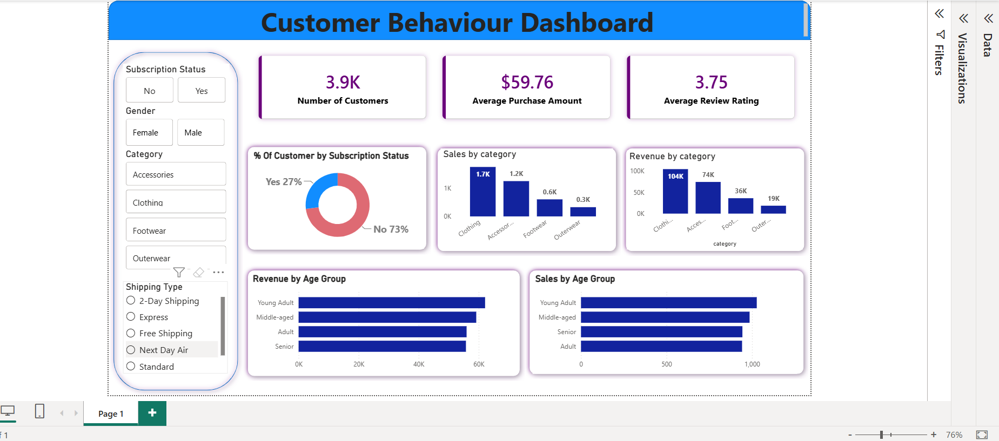

Customer Trend Data Analysis 📊

📌 Project Overview
An end-to-end data analytics project using **SQL, Python, and Power BI** to analyze customer behavior, purchasing patterns, sales performance, and revenue trends. The project transforms raw data into actionable business insights through an interactive dashboard.

🛠️ Tools & Technologies
- **SQL:** Data querying and business analysis
- **Python:** Data cleaning and preprocessing
- **Pandas:** Data manipulation and transformation
- **Power BI:** Interactive dashboard development
- **DAX:** KPI calculations and measures

📊 Key Features
- Customer behavior and demographic analysis
- Revenue and sales analysis by product category
- Customer segmentation by age group and gender
- Subscription status analysis
- Average purchase amount and review rating analysis
- Interactive dashboard with filters and KPIs

📈 Key Insights
- Identifies top-performing product categories.
- Analyzes purchasing patterns across age groups.
- Evaluates customer subscription distribution.
- Highlights revenue trends and customer preferences.

📷 Dashboard Preview

🎯 Project Objectives
- Develop practical data analytics skills.
- Extract meaningful insights using SQL.
- Clean and prepare datasets using Python.
- Present business insights through Power BI visualizations.
- Support data-driven decision-making.

🚀 Skills Demonstrated
Data Cleaning | SQL Analysis | Exploratory Data Analysis | Data Visualization | Dashboard Development | Business Intelligence
